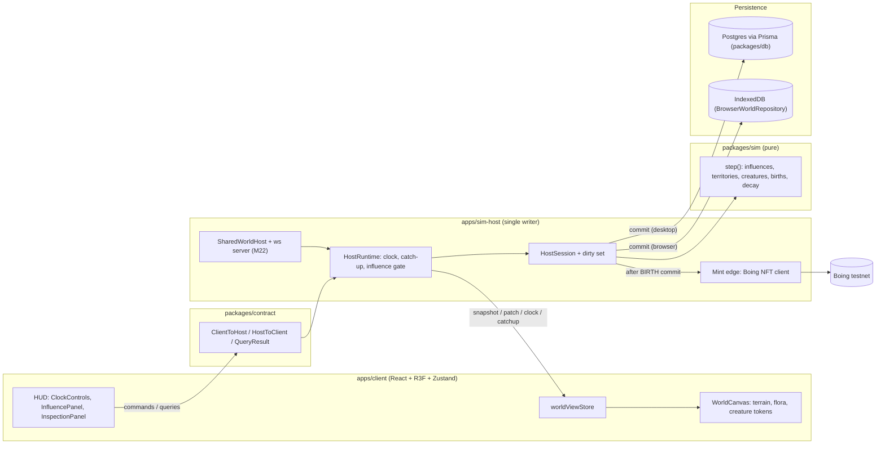

# Living Pets — Design

This document describes what the code on `main` (`76cbef0`, M22) actually does.
Items marked **planned** come from comments or commit messages, not running
features. Numbers come from `packages/sim/src/ruleset.ts` (`RULESET_V1`) unless
noted.

## Vision and pillars

1. **Creatures live on their own.** Every creature picks its own goals each
   time its action slot frees up. Nothing in the client writes needs, genes, or
   location (`apps/sim-host/src/influence.ts` header).
2. **The player influences, not controls.** Five verbs, three accepted per
   rolling 24 hours, applied by the kernel on the next tick.
3. **Time keeps passing.** Closing the game is not a pause. On the next launch
   the host replays the owed ticks with the same `step()` (offline catch-up).
4. **Deterministic and replayable.** The kernel is pure: no `Date.now`, no
   `Math.random` (enforced in `eslint.config.js`). Randomness is a pure function
   of `(seed, tick, domain, subject, salt)` (`packages/sim/src/rng.ts`).
5. **Chain at the edge.** Boing NFT minting happens only in the host after a
   durable commit, never inside `step()`, and is off by default.

## Architecture

Transports for the same contract:

- **Electron:** `ipcMain` channels in `apps/desktop/src/ipc-channels.ts`, with
  the preload bridge `apps/desktop/src/preload.ts` and the client side in
  `apps/client/src/api/electron-ipc.ts`.
- **Browser:** a dedicated Web Worker
  (`apps/sim-host/src/browser/host-worker.ts`) over `postMessage`, client side
  `apps/client/src/api/browser-host-ipc.ts`.
- **In-memory:** `apps/client/src/api/memory-ipc.ts`, used by client tests.
- **WebSocket:** `apps/sim-host/src/multiplayer/ws-server.ts` (no client yet).

Package boundaries are lint-enforced. The renderer may import only
`@boing-pets/contract`, and `npm run client:check-bundle` confirms that sim and
db code end up only in the host-worker chunk.

## Core loop (as implemented)

1. Boot: load the world from the repository, or `createWorld(seed)` and persist
   it (`apps/sim-host/src/session.ts` `bootSession`).
2. Catch-up: if wall time is ahead of `world.clockAtMs`, run the owed ticks and
   emit a `CatchupReport` (`apps/sim-host/src/catchup.ts`).
3. Live: the clock accumulates wall time × scale and steps one tick per
   `msPerTick`. It commits every 10 ticks or 30 s of wall time
   (`apps/sim-host/src/clock.ts`).
4. The client renders snapshots and patches. The player inspects a creature
   (`query.creature`, `query.family`, `query.lineage`, `query.events`) and may
   submit an influence.
5. Quit: stamp `clockAtMs = now` and persist. Time after exit is owed on next
   launch.

## Simulation model (`packages/sim`)

### Time

- 1 tick = 10 sim minutes; 144 ticks = 1 sim day.
- `msPerTick` = 60,000, so at 1× one tick passes per real minute. Scales are
  `1, 4, 16, 64` (`packages/contract/src/enums.ts` `TIME_SCALES`). The browser
  build starts at 64×.

### Tick order (`kernel/step.ts`)

1. `applyInfluences`: pending influences whose `issuedAtTick == tick`, by
   ascending id.
2. `aggregateTerritories`: effective food and danger (base plus active
   modifiers, clamped 0–1000) and living population.
3. For each living creature, in ascending id:
   - Old age: dies once lived ticks ≥ `baseLifespanDays × 144 × (500 + geneStrength) / 1000`,
     which is 0.5× to 1.5× the species lifespan.
   - Need drift, then health drift.
   - Death from drift: hunger ≥ 1000 → `STARVATION`, thirst ≥ 1000 →
     `THIRST`, health ≤ 0 → `ILLNESS`.
   - Resolve the action that ends this tick (or finish a relocate).
   - If the action slot is empty, choose a goal and start an action.
4. `resolveBirths`: mothers whose gestation ends this tick give birth.
5. `decayQuietRelationships`, then `lastTick += 1`.

### Needs (`kernel/needs.ts`, all 0–1000)

| Need       | Per-tick drift                                                                                                           |
| ---------- | ------------------------------------------------------------------------------------------------------------------------ |
| hunger     | +4 (+2 while nursing)                                                                                                    |
| thirst     | +7 (+3 while nursing)                                                                                                    |
| fatigue    | +3 awake, −12 resting, +1 nursing                                                                                        |
| discomfort | +1, +2 per head over territory capacity, +2 if danger > 500, −6 resting                                                  |
| unsafety   | moves toward territory danger (halved while resting): +8 up, −4 down (−12 resting)                                       |
| loneliness | +2, unless approaching someone; −20 while nursing beside the mother                                                      |
| health     | −40 if hunger or thirst > 950, else −15 if > 800; −5 if fatigue > 900; +5 when hunger and thirst < 400 and fatigue < 500 |

### Goal-picking AI (`ai/utility.ts`, `ai/actions.ts`)

Each eligible goal gets four terms (0–1000), and the score is
`(50·need + 20·personality + 15·relationship + 15·memory) / 100`. Highest
score wins. Ties go to higher need, then higher personality, then lower goal
ordinal. `IDLE` is never scored.

| Goal                | Eligible when                                 | Action(s) started                                                                                                          |
| ------------------- | --------------------------------------------- | -------------------------------------------------------------------------------------------------------------------------- |
| `FIND_FOOD`         | always                                        | `CONTEST` a rival (aggression and food gates), else `COOPERATE_FORAGE` with a trusted partner if food ≥ 500, else `FORAGE` |
| `DRINK_WATER`       | always                                        | `DRINK` (2 ticks, −600 thirst)                                                                                             |
| `SEEK_SHELTER`      | always                                        | `RELOCATE` (flee) if unsafety > 700 or danger > 650 and a safer link exists, else `REST` (8–24 ticks)                      |
| `SOCIALIZE`         | another creature shares the territory         | `APPROACH` the best social target                                                                                          |
| `EXPLORE`           | always                                        | `RELOCATE` to an explore destination, else `WANDER`                                                                        |
| `FIND_MATE`         | a legal partner exists                        | `COURT`                                                                                                                    |
| `PROTECT_OFFSPRING` | own juvenile in this or an adjacent territory | `GUARD` the youngest here, else relocate toward them                                                                       |

Newborns start with `NURSE`. A losing `CONTEST` can kill with cause `INJURY`.

### Memories (`memories/`)

- Kinds: conversation, gift, rescue, parent death, first child, threat, mate,
  discovery, migration, conflict, cooperation (`MemoryKind`).
- Strength decays with a half-life of 2,880 ticks (20 days) for minor memories
  and 43,200 ticks (300 days) for major ones (importance ≥ 25).
- The utility memory term uses the 32 strongest ("hot") memories. Repeat
  memories are throttled (144 ticks; 72 for conflict).

### Relationships (`relationships/`)

- Per-pair friendship, romance, conflict, avoidance, trust, cooperation, and
  score. Pairs are created on first `APPROACH` or at birth (parent–child).
- Deltas come from socialize, snub, contest, cooperate-forage, gift, rescue,
  court accept/reject, and guard.
- Quiet relationships decay once per sim day.

### Genetics, courtship, and birth (`genetics/inherit.ts`, `kernel/birth.ts`)

- Genes: strength, speed, intelligence, curiosity, sociability. Traits:
  curiosity, aggression, loyalty, sociability, bravery, risk-taking.
- Legal partners: opposite gender, same territory, both mature, not gestating,
  past cooldown, healthy and fed enough (health ≥ 600, hunger and thirst ≤ 500),
  and low conflict. Cross-species fertility is `0` in v1, so only same-species
  pairs can breed.
- Mutations: a roll from 0–999; below 2 is rare (±80–160), below 17 is minor
  (±40).
- Litter size 1. Gestation is the species `gestationDays`. Cooldowns are 48
  ticks for males and postpartum.
- A child joins the **mother's lineage** at generation max(parents) + 1
  (`family/lineage.ts`). Extinction is computed (no living members), never
  stored (`packages/db/src/family.ts`).

### Migration and discovery

- `RELOCATE` travels territory links (seven two-way links, 5–8 ticks each; see
  "World and species").
- Migration reasons are `FLEE`, `SETTLE`, and `PROTECT`, and each writes a
  `MIGRATION` memory and event.
- Each lineage records one `DISCOVERY` per territory it reaches.

### Offline catch-up (`catchup/run.ts`, `apps/sim-host/src/catchup.ts`)

- Owed ticks = ⌊(now − clockAt) / msPerTick⌋.
- The same `step()` runs N times, committing every 500 ticks.
- A `CatchupReport` ranks notable events (rare-mutation births, deaths in
  favored lineages, and so on) via `catchupEventRank`.
- Influence submits are rejected with `catching_up` while catch-up runs.
- The client stores `world.catchup` in `worldViewStore.lastCatchup`, and
  `hud/CatchupPanel.tsx` shows it once as "While you were away": world time
  passed, the tallies, and up to five ranked highlights, dismissed with
  Continue (seen reports are remembered per world in `localStorage`). A
  shared host replays its launch report to players who join later.

### Determinism

- RNG is splitmix64 / FNV-1a over `(seed, tick, domain, subjectId, salt)`. The
  domains are worldgen, name, genetics, personality, forage, and contest.
- Integer math only (`assertInteger`), and every iteration order is fixed.
- `canonicalHash` (SHA-256 over canonical JSON, `hash.ts`) pins the seed-1
  founder world in `packages/sim/test/determinism.test.ts`. The golden hash
  last changed on purpose in the species/map pass (species 1–3 renamed, four
  species, four territories, and sixteen founders added); founders 1–12 kept
  their ids, names, genes, and traits because founders are generated in
  ascending species id, which matches the old slug order for ids 1–3. It
  changed again in the bestiary pass: 21 species with 2 founders each (42
  founders, born mature) instead of 7 × 4, plus per-species biology.
  `catchup-equivalence.test.ts` checks that catch-up equals live stepping.

## World and species

`worldgen/catalog.ts` holds the species biology, territories, and links, and
`worldgen/create-world.ts` builds one world, "Living World", from it.
Territory ids follow catalog order, so the original three keep ids 1–3.

| Territory (id, slug) | Name          | Food | Danger | Capacity | Client biome            |
| -------------------- | ------------- | ---- | ------ | -------- | ----------------------- |
| 1 `meadow`           | Meadow        | 700  | 200    | 40       | meadow (pond)           |
| 2 `thicket`          | Thicket       | 500  | 450    | 30       | thicket (swamp)         |
| 3 `ridge`            | Ridge         | 350  | 700    | 20       | ridge (tarn, peak)      |
| 4 `glade`            | Moonlit Glade | 650  | 250    | 35       | glade (pond)            |
| 5 `fen`              | Glowfen       | 600  | 350    | 30       | fen (swamp, low)        |
| 6 `grove`            | Elder Grove   | 550  | 400    | 28       | grove (pond, dark wood) |
| 7 `crags`            | High Crags    | 300  | 600    | 18       | crags (tarn, peak)      |

Links (two-way, travel ticks): meadow–thicket 6, thicket–ridge 8,
meadow–glade 5, glade–grove 6, grove–thicket 6, thicket–fen 7,
ridge–crags 7. The graph is connected, and the meadow–glade–grove–thicket
loop gives creatures a second route between the lowlands.

There are 21 species, three per territory, and 2 founders per species (one
female, one male), for 42 total. Each founder starts its own lineage in its
species' home territory. Founders are born mature: their `birthTick` is
`-maturityDays × ticksPerDay`, so they can court from day one (stored ticks may
therefore be negative for founders; the DB mapper reads `birth_tick` signed).

| Species (`id`, slug, name)           | Home    | Also lives in  | Diet        | Gait / body plan  | Maturity / lifespan / gestation / juvenile (days) | Forage skill |
| ------------------------------------ | ------- | -------------- | ----------- | ----------------- | ------------------------------------------------- | ------------ |
| 1 `fire-fox` Fire Fox                | meadow  | glade          | OMNIVORE    | trot / canid      | 90 / 900 / 18 / 16                                | 40           |
| 2 `moss-stag` Moss Stag              | thicket | grove          | HERBIVORE   | walk / cervid     | 140 / 1400 / 30 / 28                              | 0            |
| 3 `lantern-moth` Lantern Moth        | ridge   | crags          | HERBIVORE   | fly / moth        | 70 / 700 / 14 / 12                                | 60           |
| 4 `glow-tortoise` Glow Tortoise      | fen     | thicket        | HERBIVORE   | crawl / chelonian | 160 / 1800 / 36 / 32                              | 0            |
| 5 `moon-hare` Moon Hare              | glade   | meadow         | HERBIVORE   | hop / lagomorph   | 60 / 600 / 12 / 10                                | 30           |
| 6 `crag-ram` Crag Ram                | crags   | ridge          | HERBIVORE   | walk / bovid      | 120 / 1100 / 24 / 20                              | 80           |
| 7 `thistle-hog` Thistle Hog          | grove   | thicket        | OMNIVORE    | trot / suid       | 80 / 800 / 16 / 14                                | 40           |
| 8 `barrow-badger` Barrow Badger      | meadow  | thicket        | OMNIVORE    | waddle / mustelid | 100 / 1000 / 20 / 18                              | 60           |
| 9 `field-nightjar` Field Nightjar    | meadow  | glade          | INSECTIVORE | fly / nightjar    | 60 / 650 / 12 / 10                                | 50           |
| 10 `shade-lynx` Shade Lynx           | thicket | grove, ridge   | CARNIVORE   | walk / felid      | 120 / 1100 / 22 / 22                              | 80           |
| 11 `dusk-raccoon` Dusk Raccoon       | thicket | fen, grove     | OMNIVORE    | waddle / mustelid | 90 / 850 / 18 / 16                                | 60           |
| 12 `slate-marmot` Slate Marmot       | ridge   | crags          | HERBIVORE   | bound / rodent    | 90 / 900 / 18 / 16                                | 60           |
| 13 `gloam-bat` Gloam Bat             | ridge   | crags, thicket | INSECTIVORE | fly / bat         | 70 / 1000 / 16 / 14                               | 70           |
| 14 `silver-deer` Silver Deer         | glade   | meadow, grove  | HERBIVORE   | walk / cervid     | 120 / 1200 / 26 / 24                              | 20           |
| 15 `dew-shrew` Dew Shrew             | glade   | meadow, fen    | INSECTIVORE | scurry / rodent   | 45 / 450 / 10 / 8                                 | 90           |
| 16 `reed-heron` Reed Heron           | fen     | thicket        | CARNIVORE   | wade / heron      | 110 / 1300 / 22 / 20                              | 60           |
| 17 `ember-newt` Ember Newt           | fen     | thicket        | INSECTIVORE | crawl / urodele   | 80 / 1000 / 16 / 14                               | 40           |
| 18 `hollow-squirrel` Hollow Squirrel | grove   | thicket, glade | HERBIVORE   | bound / rodent    | 70 / 700 / 14 / 12                                | 70           |
| 19 `ash-wolf` Ash Wolf               | grove   | thicket, glade | CARNIVORE   | trot / canid      | 130 / 1200 / 22 / 24                              | 70           |
| 20 `stone-pika` Stone Pika           | crags   | ridge          | HERBIVORE   | hop / lagomorph   | 60 / 600 / 12 / 10                                | 60           |
| 21 `crag-owl` Crag Owl               | crags   | ridge          | CARNIVORE   | fly / owl         | 120 / 1400 / 24 / 22                              | 70           |

Ids 1–7 are the original seven and never change; new species are appended.

### Biology

Biology lives in code, keyed by species id (`worldgen/catalog.ts`,
`kernel/biology.ts`), so worlds stored by an older build pick it up on load
without new columns:

- **Needs:** per-tick hunger / thirst / fatigue offsets on top of the shared
  drift (a shrew burns food faster; a tortoise or newt needs less).
- **Diet:** `HERBIVORE` forages on territory food. `OMNIVORE`, `INSECTIVORE`
  and `CARNIVORE` lean less on plant food (`dietFoodBase`); carnivores eat
  more per success and a little less per miss. There is no predation between
  creatures: `CARNIVORE` means small unmodelled prey.
- **Forage skill** adds to forage chance; genes are drawn around each
  species' gene centres.
- **Habitat:** home plus extra territories. Danger inside the habitat feels
  half as bad, exploration stays inside it, and settling there is favoured, so
  each species keeps to its range instead of crowding the meadow.
- **Balance guards:** survival needs (hunger, thirst) above 600 become urgent;
  guarding offspring yields to a parent's own hunger and thirst; a nursing
  infant beside its mother gets milk; breeding stops when a territory is full
  or the species' kin fill more than half of it.

`packages/sim/test/ecology.test.ts` runs seeds 1 and 7 for 150 days: every
species must end with ≥ 2 alive and peak at ≤ 24, there must be ≥ 42 births,
the population must grow but stay at or under the summed capacity (201), and
thirst plus starvation deaths must stay ≤ 3. Longer runs (365 days) keep all
21 species alive on both seeds (193 and 213 alive; deaths are illness and old
age).

### Introducing species into an existing world

`worldgen/introduce-species.ts` (`introduceSpecies`) runs at every host boot
on a loaded world (`apps/sim-host/src/session.ts`):

1. Species already stored get their catalog diet refreshed (fire-fox and
   thistle-hog become `OMNIVORE`). Nothing else on them changes.
2. Each catalog species missing from the world is added with its
   compatibility rows and **two founders** (female, male) in its home
   territory at the world's `lastTick`, with BIRTH/DISCOVERY events, using the
   world's id cursors and names unique against every existing creature.
3. The result is committed at once, before any tick or catch-up. It is
   deterministic, so a crash before that commit re-derives the same rows on
   the next boot, and idempotent: a world that is up to date changes nothing.

It never deletes, resets or rewrites existing creatures, lineages, memories or
history. On deploy, `prisma migrate deploy` first adds the new `Diet` enum
values (`20261122090000_bestiary_diets`); the first host boot then adds the 14
new species × 2 founders to the live world. Founder BIRTH events go through the
same after-commit mint queue as worldgen founders (they only mint if the mint
edge is enabled). Stored rulesets keep their own `founderCountPerSpecies`,
which only matters at world creation.

### Species naming

There is one name per species. `packages/contract/src/species.ts`
(`SPECIES_CATALOG`) is the canonical table of id, slug, and display name. The
sim catalog maps over it (a test checks they match), and the client's skin id
is the slug and its label is the display name, so the kernel, HUD, and
renderer always agree.

Species 1–3 used to be `fernfox`, `mossback`, and `pebblehare` in the kernel
while the client drew a fire fox, moss stag, and lantern moth. The kernel now
uses the presentation names. Ids did not change, so existing saves still
render the right mesh. `LEGACY_SPECIES_SLUGS` / `speciesKeyForSlug` resolve
the old slugs for any stored row or tool that still has them; stored species
rows in an old save keep their old slug until that world is regenerated.

The scale rehearsal (`create-scale-world.ts`) keeps using only species and
territories 1–3 so its timings stay comparable.

## Player influences

`packages/contract` `InfluenceKind`, applied in `kernel/influences.ts`:

| Verb               | Effect                                                                |
| ------------------ | --------------------------------------------------------------------- |
| `NAME_CREATURE`    | Sets the name and `nameGivenByPlayer = true`.                         |
| `NAME_LINEAGE`     | Renames the lineage.                                                  |
| `FAVOR_BLOODLINE`  | `lineage.playerFavor += 100` (max 1000). See "Bloodline favor" below. |
| `ENRICH_TERRITORY` | `FOOD` modifier +150 for 5 days (720 ticks).                          |
| `CALM_TERRITORY`   | `DANGER` modifier −100 for 5 days.                                    |

- **Bloodline favor.** A favored lineage forages better: every forage roll
  of its members gains ⌊playerFavor / `favorForageDivisor`⌋ per mille
  (divisor 4, so one favor of 100 is +2.5 %, the cap of 1000 is +25 %, still
  clamped to `forageChanceMax`). Better food means fewer hunger deaths and
  more healthy parents, so the bloodline tends to grow. Favor fades by
  `favorDecayPerDay` (10) at every day boundary, floor 0, so one favor lasts
  about ten world days unless renewed. Integer math and no new RNG draws keep
  the kernel deterministic; health, genes and needs are never written
  directly. Favor still also ranks catch-up highlights. Worlds saved before
  these knobs existed pick up the defaults on load (`persist/load.ts`).
- **Rate limit** (`apps/sim-host/src/influence.ts`): 3 accepted per rolling
  24 h of wall time (`INFLUENCE_RATE_LIMIT`, `INFLUENCE_RATE_WINDOW_MS`), per
  gate. Single-player uses one `"local"` gate, multiplayer one gate per account
  id.
- The accept log persists in `host-meta.json` (desktop) or in the repository
  (browser).
- Accepted influences are queued for `lastTick + 1`.

## Items (M22, slice 1)

The item catalog is code in `packages/contract/src/items.ts`, deliberately **not**
part of the frozen ruleset, so the live world picks it up without a ruleset
migration. The kernel never stores inventory; it only sees two new influence
verbs (`packages/sim/src/kernel/items.ts`, `kernel/influences.ts`):

- **GATHER_RESOURCE** takes units from a territory's shared stock: Clover
  (Meadow), Glowmoss (Glowfen), Crystal shard (Ridge, High Crags), Moonpetal
  (Moonlit Glade). Each listed territory has a stock of 12 units. A gather
  yields 1–3 units from `rngInt(seed, tick, "gather", territory, influenceId)`,
  capped by free stock (`gatherYield`, pure; the host grants it at accept and
  the kernel re-clamps). Each unit is a HARVEST modifier of −10 food for two
  days, so gathering eats from the same pool creatures forage from and the
  stock regrows when the modifier ends.
- **USE_ITEM** applies a catalog effect: Seed bundle (food +100, 7 days),
  Salt lick (COMFORT 2: thirst and discomfort drift −2 per tick, capped at 3
  total, 3 days), Rations Pack (food +75, 3 days), Calm Potion (danger −50,
  3 days), Vitality Potion (favor +50), relics (favor +25; the host enforces
  once a week per relic).
- **Relic triggers** (`relicTriggers`): a lineage's first non-founder BIRTH is
  its First Child relic (recipient resolved from the mother), its first DEATH
  its Remembrance relic (from the deceased). "First" is the host mint key.

Both verbs count against the existing 3-per-24h influence budget. Worlds with
no item influences step exactly as before. Schema migration
`20261123090000_items_slice` only adds enum values (`ADD VALUE IF NOT EXISTS`).

### Items on the host (M22, slice 2: `apps/sim-host/src/items/`)

- **Inventory** is off-chain: `inventory_lot` rows (migration
  `20261123100000_inventory`, new tables only). Lots are keyed by source
  (`gather:<influenceId>`, `craft:<lotId>`, `mint:<assetMintKey>`) so every
  write is idempotent. Resources spoil 3–7 days after gathering and tools 7
  days after crafting, counted in sim ticks. Debits take the soonest-spoiling
  lot first.
- **Who can hold items**: wallet accounts and the local single-player account.
  Guests cannot gather, craft or use (anti-farming, like rewards).
- **Gather** grants units at accept time with the kernel's `gatherYield`; the
  client cannot choose the resource or the yield. Gather and use-item are
  influences, so they share the 3-per-24h budget. **Crafting** is a host
  command (`item.craft`), not an influence, and costs no budget.
- **LPIT rewards** (Vitality, Calm, Rations) are mirrored into the bag from
  their asset mint rows at boot and after each reward, whatever their mint
  status (rows marked FAILED before the LPIT collection existed included).
  Using one debits the off-chain lot; the on-chain LPIT balance is **not
  burned** (see slice 3), so usage is tracked in the DB. Boot also kicks a
  mint drain so FAILED rows retry once `LIVING_PETS_BOING_ITEM_COLLECTION_HEX`
  is set.
- **Relics** are LPAR NFTs, not lots. A lineage's first non-founder birth
  mints its First Child relic (`relic:first-child:<lineage>`, serial
  lineage×4+2) and its first death its Remembrance relic
  (`relic:remembrance:<lineage>`, serial lineage×4+3, the GRIEF
  commemorative). Recipient: the trigger creature's on-chain owner (read with
  `owner_of`); if the operator holds it or it was never minted, the lineage's
  top favor-giver from `influence_account` (most favors, then earliest, then
  account id); otherwise the operator. Honoring a relic (USE_ITEM) needs the
  wallet to hold it and works once per 7 days per relic.
- `influence_account` records which account issued each accepted influence
  (favor ranking, relic cooldowns, item-use audit). It starts empty on the
  live world; earlier favors are not attributed.

### Items on chain (M22, slice 3)

- **LPIT** ("Living Pets Items", reference multi-token
  `boing.reference_multi_token.v1`) holds the Vitality Potion (id 1), Calm
  Potion (2) and Rations Pack (3) rewards. **Not deployed yet.** A simulated
  deploy from the operator (Nov 20 2026, testnet 6913, nonce 129) succeeded:
  220,799 gas, fee **0.00220799 BOING**, QA `allow`, bytecode 2,334 bytes,
  predicted address `0x4877b234…4fa3f96` (nonce-derived; changes if the
  operator sends anything first). Deploy runbook: deploy the multi-token from
  the operator, set `LIVING_PETS_BOING_ITEM_COLLECTION_HEX` as a Fly secret via
  stdin, restart. The boot drain then retries every FAILED item reward row
  (they failed with "LIVING_PETS_BOING_ITEM_COLLECTION_HEX required") and the
  rows already mirrored in inventories are not duplicated.
- **Burning**: the pinned multi-token template exposes balance_of, transfer,
  mint, set_item_metadata, mint_batch, transfer_batch, total_supply,
  item_metadata, admin and transfer_admin. There is **no burn**, and the host
  cannot move a player's balance. So using an LPIT item debits the off-chain
  inventory lot and the token stays in the wallet as a keepsake of the reward;
  the DB is the source of truth for "used". A later slice could ask the wallet
  to `transfer` the unit to a sink account when it is used.
- **Market**: First Child and Remembrance relics (LPAR, already allow-listed
  in the escrow) appear in the Items tab as listable. LPIT items appear there
  too with `escrowListable: false` and a note: the escrow only holds single
  reference NFTs (`owner_of`/`transfer_nft`), so multi-token balances cannot
  be listed until a multi-token escrow exists.

## Time controls (`apps/sim-host/src/clock.ts`, `hud/ClockControls.tsx`)

- **Pause:** freezes stepping. While paused, `clockAt` snaps forward (at most
  every 10 s), so paused time is discarded rather than owed.
- **Resume:** continues without replaying the paused gap.
- **Scale:** 1×, 4×, 16×, or 64×. The contents of a tick do not change with
  scale. The chosen scale is saved with the world (`hostClock`); pause is not,
  because quitting is not a pause.

## Movement (`packages/sim/src/ai/movement.ts`)

- Every creature has an authoritative spot (`spotX/spotZ`) and the spot it
  is walking from (`fromSpotX/fromSpotZ`), in territory-local permille
  integers. Land spots lie within radius 900; a value beyond 1000 is a shore
  spot (radius 1200) that the client resolves to the nearest water edge.
- `startAction` calls `planMove`, which picks the destination from the action
  (rest at the nest, drink at the shore, social/court beside the partner,
  forage/explore at a settle spot) using the stateless `rng(..., "move", ...)`
  domain, so moves never perturb other random draws. Relocation starts from
  the old territory's edge; newborns appear at the mother's spot.
- The client (`view/motion/trajectory.ts`) walks a token from `fromSpot` to
  `spot` over the action window: it estimates a fractional sim tick from the
  last `world.clock` and its receipt time, caps the walk at a natural speed
  for the current scale, follows trails when relocating, and picks the gait
  from distance. Two clients with the same clock render the same positions.

## Persistence

- `WorldRepository` (`apps/sim-host/src/persist/repository.ts`) commits atomic
  batches with explicit kernel-assigned ids and no DB sequences.
- Only dirty rows are written (`persist/dirty.ts`). Every living creature is
  dirty each tick, because its needs drift.
- **Desktop:** `PrismaWorldRepository` writes to embedded Postgres, one
  transaction per commit (Prisma 7 with the `@prisma/adapter-pg` driver
  adapter; `createDbClient` takes the URL, and the CLI reads it from the root
  `prisma.config.ts`). The schema is in `packages/db/prisma/schema.prisma`,
  with 4 migrations, and `CURRENT_SCHEMA_VERSION = 2`
  (`20261120120000_creature_positions` adds the four spot columns, default 0).
  Load refuses newer schemas (`SchemaTooNewError`).
- **Browser:** `BrowserWorldRepository` uses the same commit semantics over
  IndexedDB (database version 2, key `v2`). A v1 save is read once, upgraded,
  and the v1 record is left in place as a backup.
- **Upgrading old saves:** `upgradeSnapshotPositions` places every creature of
  a schema-1 world at a settle spot, then re-plans in-progress actions at
  their start tick. It is a pure function of the save, and the boot marks all
  creatures dirty, so a crash during the first save simply repeats it.
- **Shared-world server:** JSON file store (atomic temp-file + rename) by
  default, or `PrismaWorldRepository` with `DATABASE_URL`.
- **Tests:** `MemoryWorldRepository`.
- **Single writer:** `HostRuntime` either steps or handles a command, never
  both at once. On a crash, in-memory state is discarded and the next boot
  reloads the last successful commit. Re-running reaches the same hash as a
  clean run (`apps/sim-host/test/crash-redo.test.ts`).

## Client and view architecture (`apps/client/src`)

- `state/worldViewStore.ts` mirrors host `WorldView` and applies
  `world.patch`. `state/uiStore.ts` holds selection, pause, and scale.
- `view/world/*` turns the territory graph (seven nodes in v1) into one
  continuous night landscape: terrain, water, flora, sky, and glow points. It
  is deterministic from the seed and graph, and is never saved or fed back to
  the sim. Each biome (`biomes.ts`) picks a flora family
  (meadow/thicket/ridge), a water kind, and whether it has a peak, so new
  biomes reuse the instanced flora instead of adding geometry. Region radius
  is `clamp(24 + capacity × 0.36, 24, 52)`. Water sits beside the principal
  axis of a region's links, which keeps rivers out of region hearts even
  when two neighbours lie on the same side. The terrain grid stays capped at
  380k cells, so a bigger map means slightly coarser cells, not more memory.
- `view/motion/*` maps the sim goal/action to a presentation behavior
  (forage, drink, rest, social, court, and so on) and to waypoints from
  deterministic anchors. Creatures free-roam visually across regions, while
  their sim location stays the territory id.
- `view/creatures/*`: procedural creatures for all 21 species (see
  [Creature rendering](#creature-rendering)). The repo has no model or
  texture assets.
- HUD: `InspectionPanel` (creature, family, top memories), `InfluencePanel`
  (all five verbs), and `ClockControls`.

### Creature rendering

The goal is creatures that belong in the night landscape: natural
proportions, muted coats, the same moonlight and fog as the terrain, and
motion with weight. Everything is generated in code.

- **Anatomy** (`view/creatures/anatomy/`). `species.ts` gives each species
  an `Anatomy`: a coat (back, belly, dark), an optional pattern function,
  rig info (gait, stride, breath rate, height, look range) and a build
  function. `plans.ts` holds the body plans that build functions call:
  `quadruped` (lofted torso with waist, neck, head with eyeshine, ears, jointed
  legs with paws or hooves, tails), `bird` (wading or flying), `bat`, `moth`,
  `tortoise` and `newt`. `builder.ts` (`CreatureBuilder`) turns ellipsoids,
  tubes, cones, swept lofts and wing membranes into one merged geometry per
  animated part (body, head, legs, tail, wings). It paints each vertex with
  countershading, coat noise, underside and ground occlusion (not for fliers),
  pattern colour and glow.
- **Shading** (`anatomy/material.ts`). Every creature shares two
  `MeshStandardMaterial`s: `creatureSkin` (front faces) and
  `creatureMembrane` (double-sided wings with a little moonlit
  translucency). A shader patch adds fur, feather or scale grain (fading
  with distance), glossier eyes and noses, a faint cool rim, and a slow pulse
  on bioluminescent spots. Creatures are lit only by the world's moon,
  hemisphere light and `FogExp2`. There are no per-creature lights.
- **Ground contact** (`GroundContact.tsx`). One shared soft decal under each
  creature, plus the moon's shadow. A flier's decal stays on the ground under
  it.
- **Animation** (`ProceduralCreature.tsx`, `useFrame`). Breathing, weight
  shift, and per-gait leg cycles (walk, trot, bound, hop, waddle, scurry,
  crawl, wade, fly) with a planted stance phase and a lifted swing. Also body
  bob/roll/pitch, a newt's body wave, head look-around (or toward the camera
  when selected), tail sway, wing beats with hind-wing lag, and a crouch for
  rest. Gait weight and pitch come from the shared `CreaturePose`.
- **Cost and LOD** (`anatomy/rig.ts`, `crowd.ts`, `CreatureCrowd.tsx`). Rigs
  are built once per species and cached. A close creature costs 6–7 draw
  calls plus its shadow, with 2k–10k triangles. Past 60 units (and when not
  selected), a creature hides its parts and joins its species'
  `InstancedMesh` of a merged, roughly half-detail far body, so a whole
  species far away is one draw call. `test/anatomy.test.ts` checks that every
  species has a distinct body and stays within the triangle budgets.
- **Bestiary** (`dev/Bestiary.tsx`, lazy). `?bestiary` lays out all species
  under the world lighting; `?bestiary=<slug>` frames one close up;
  `&pose=` picks a pose.

## Multiplayer (shared world)

- `npm run mp:serve` (`multiplayer/serve.ts`) runs one `HostRuntime` (the
  single writer) behind `listenSharedWorldWs`. Default bind `127.0.0.1:8787`.
- **Protocol v2** (`packages/contract/src/ws.ts`, `multiplayer/ws-protocol.ts`):
  the client sends `hello {v, token?, name?, ownerKey?}`; the server answers
  `welcome {accountId, role, displayName, token}` and then `host` frames.
  Every `host` frame carries a `seq`; join and resync snapshots are marked
  `base`. A client that sees a gap drops live frames and sends `resync`.
  `ping`/`pong` measure latency; `error` is recoverable, `fatal` closes.
- **Identity:** session tokens are HMAC-SHA256 over
  `{sub (account id), role, name, iat, exp}` with a server secret
  (`LIVING_PETS_MP_SECRET` or `<data>/session-secret`). A bad or expired token
  is refused (`invalid_token`) and the socket joins as a fresh guest. A
  `hello` with the owner key (constant-time compare) gets the `owner` role.
- **Wallet sign-in:** a socket may send `auth-challenge {address}` (before
  or after `hello`, at most 8 per socket). The server answers with a
  one-time message bound to the page origin, chain id (6913, Boing testnet),
  address, nonce, issue and expiry times (5 min):
  `Boing Pets sign-in v1\nOrigin: …\nChain: 6913\nAddress: 0x…\nNonce: …\nIssued: …\nExpires: …`.
  Boing Express signs it with `boing_signMessage` (no transaction); the
  client reconnects with `hello {wallet: {address, nonce, signature}}` and the
  server checks Ed25519(signature, BLAKE3(UTF-8 message), address), the same
  scheme as the old pasture app. The nonce is consumed whatever the outcome.
  Success joins as account `w:<64 hex>` (display name `0x1a2b3c…9f0e` unless
  `name` is given) and the session token carries `wallet`, so reloads stay
  signed in without a new signature. A bad, replayed or expired proof gets
  `wallet_rejected` and joins as a guest; guests keep playing as before.
- **Owner role:** wallets listed in `LIVING_PETS_MP_OWNER_WALLETS` get `owner`
  on every join (a wallet's role is recomputed from that list, never taken
  from its token). The owner key still works as a fallback.
- **Presence:** clients send `presence {x, z}` (their camera focus) at most
  5 times a second and only when it moves; the server rounds to 0.01, ignores
  faster frames, and every 250 ms, when anything changed, sends everyone one
  `players` frame (session id, name, role, wallet flag, x, z; at most 64).
  Presence is cosmetic: it is not part of `seq`, never queued behind a slow
  socket, and leaves the sim untouched. The client draws each other player as
  a cone, ring and name label (owner violet, wallet gold, guest blue), eased
  toward the latest position each frame and placed on the terrain height.
- **Authority:** only the owner may pause, resume or rescale
  (`not_owner` notice otherwise). Influences keep their per-account budgets.
- **Limits:** 64 KiB `maxPayload`; every command and query is rebuilt by a
  strict validator; a per-socket token bucket (20/s, burst 40) answers
  `rate_limited` and closes persistent floods; a socket with more than 4 MB
  queued is skipped and rebased once the backlog halves; a heartbeat drops a
  socket after four silent 15 s intervals (any inbound frame counts).
- **Bandwidth:** live `world.patch` frames carry only rows and events that
  changed since the previous emit (`PatchBaseline`). Creatures go per field:
  a creature the listeners already hold travels as a `creatureDeltas` entry
  with just its changed top-level fields (nested objects such as `needs` are
  replaced whole); a new creature goes out as a full row. Every 60th live
  view is a full `world.snapshot` keyframe, which heals any drifted listener
  and older clients that ignore deltas. Both sides merge with the contract's
  `applyWorldPatch`. With 28 creatures this took the live stream from ~53 KB
  to ~7 KB per tick (keyframes included). Seq gaps still trigger `resync`.
- **Client** (`api/ws-host-ipc.ts`): `?mp=ws://…` or `VITE_LIVING_PETS_MP_URL`
  selects it (the Vercel deployments default to Fly; `?mp=off` opts out). It
  keeps the token per server URL in `localStorage`, reconnects
  with backoff (0.5 s doubling to 8 s), and reports `connecting/live/
reconnecting` to the HUD.

- **Hosting:** production runs the bundled server (`apps/sim-host/dist/server.mjs`,
  `Dockerfile`) on one always-on Fly.io machine with Fly Postgres. With
  `NODE_ENV=production` it refuses to start without the owner key, session
  secret, `DATABASE_URL` and an origin allow-list; WebSocket upgrades from
  other origins get 403; `GET /healthz` backs the Fly health check; the
  host-meta sidecar lives in the `host_meta` table because the machine disk is
  replaced on deploy. See README "Hosting on Fly.io".

## On-chain integration (Boing testnet, `apps/sim-host/src/boing/`)

- **Off by default.** It runs only when `LIVING_PETS_BOING_MINTING` is truthy.
  Otherwise `DisabledBoingNftClient` makes no network calls and writes no link
  rows. The browser build never enables it.
- **M19:** `SdkBoingNftClient` uses `@boing-network/boing-sdk` reference NFT
  collection and multi-token templates. It has `probe()` and `plan*Deploy()`
  helpers, but nothing in the app calls them. Collections must already be
  deployed and configured by env.
- **M20, creature NFT at birth:** after a durable `BIRTH` commit (founders at
  worldgen and live births), `enqueueBirthMintsAfterCommit` queues one
  `UNIQUE_CREATURE` mint per child. Status moves `PENDING → SUBMITTED →
CONFIRMED`, or `FAILED`, which can be retried. Links persist in
  `CreatureNftLink`. A missing collection marks the mint `FAILED`. Mint
  failures never throw into the tick or commit path.
- **M21, asset taxonomy** (`taxonomy.ts`): `UNIQUE_LINEAGE_ARTIFACT` (unique
  NFT) and `COMPRESSED_ITEM` (multi-token, fungible-like), persisted in
  `AssetMintLink`. The mint edge exposes `queueLineageArtifactMint` and
  `queueCompressedItemMint`.
- **Player rewards** (`influence-rewards.ts`): when a wallet player's
  influence lands, the host queues a reward minted **to that player's
  wallet** (stored as `AssetMintLink.recipientHex`): Enrich → Rations Pack,
  Calm → Calm Potion, Favor → Vitality Potion (one compressed item each), and
  Name lineage → that lineage's Keepsake (unique artifact; the first wallet to
  name a lineage keeps it). Naming a creature earns nothing (creatures mint at
  birth). Guests and owner-key sessions earn nothing, so a reward never falls
  back to the operator. Mint keys come from the influence or lineage id, so
  retries never double-mint. The shared server (`multiplayer/serve.ts`) now
  builds its mint edge from the environment, still off by default.
- **Recipient:** player rewards go to the player's wallet. Creature mints at
  birth go to `LIVING_PETS_BOING_NFT_RECIPIENT_HEX`, or else the address
  derived from `BOING_SECRET_HEX`, which means the operator.

## Trust and security model

- The host is the only writer and authority. Clients get derived views and can
  only submit the five validated verbs (`assertValidSubmit`).
- The kernel has no I/O, wall clock, or randomness source, so a world is
  reproducible from its seed plus its influence log.
- The signing key comes only from the environment. A browser build has no
  `process.env`, so it cannot mint. The bundle check blocks `DATABASE_URL` and
  Prisma.
- Desktop: the host connects to embedded Postgres at `127.0.0.1` with a fixed
  local password in `apps/desktop/src/main.ts`. The Electron window has `contextIsolation: true`,
  `nodeIntegration: false`, and `sandbox: false`.
- Shared world: identity is a signed guest token, not a login, so a player
  who clears storage becomes a new guest with a fresh influence allowance. The
  owner key is a shared secret carried in a URL (scrubbed after join). Traffic
  is plain `ws://` unless you put a TLS proxy in front.

## Milestone history (from `git log`)

Before M1, the Nov 14–15 commits extended the old Boing Pets "Yard" game
(Quarry gather loop, vault mint, vinyl accessories). Then `b116e6a` removed it.

| M   | Commit(s)            | Summary                                                                |
| --- | -------------------- | ---------------------------------------------------------------------- |
| M1  | `4d36b59`, `b116e6a` | Contract and sim skeleton; old pasture app removed.                    |
| M2  | `25d27dc`            | Prisma schema and SQL checks.                                          |
| M3  | `4f8b21d`            | Deterministic worldgen and canonical founder hash.                     |
| M4  | `3451aed`            | Tick drift, death, starvation event.                                   |
| M5  | `545c5f6`            | Relocate travel, migration, one discovery per lineage.                 |
| M6  | `20999ff`            | Utility AI scoring, tie-break, action table.                           |
| M7  | `c88d84e`            | Memory decay, throttles, memory utility term.                          |
| M8  | `4e1b8cf`            | Relationship create, deltas, daily decay.                              |
| M9  | `5b388af`            | Genetics, court, gestation, birth.                                     |
| M10 | `57ae6f4`            | Family SQL, maternal lineage, computed extinction.                     |
| M11 | `1deaf4e`            | Load, dirty save, explicit ids, crash redo.                            |
| M12 | `9137ff6`            | Offline catch-up and `CatchupReport`.                                  |
| M13 | `b9bbc8c`            | Pause and time scale on the host clock (inferred; branch tip differs). |
| M14 | `c6abd8b`            | Five influence verbs and host rate limit.                              |
| M15 | `24c80c0`            | React shell, Zustand, IPC, R3F territory tokens.                       |
| M16 | `8d2710c`, `3beabe1` | Inspection HUD, host queries, selection and name picker (inferred).    |
| M17 | `3627566`            | Scale rehearsal: 5,000 creatures.                                      |
| M18 | `14010db`            | Electron shell and local Postgres cold boot.                           |
| M19 | `9e6184a` (#63)      | Boing NFT client at the host edge.                                     |
| M20 | `f5deeb9` (#65)      | Creature NFT mint at birth.                                            |
| M21 | `6cfcd75` (#66)      | Asset mint taxonomy.                                                   |
| M22 | `76cbef0` (#68)      | Multiplayer host seam.                                                 |

Unnumbered work between M18 and M22:

- `f195897`: FORAGE/DRINK resolution.
- Visual creature skins and atmosphere (#52).
- Vercel client build (#53).
- Open night map, sim-driven motion, realistic materials, free-roam (#58).
- GUARD fix and MIGRATION memories (#59).
- Pause, scale, and influence HUD (#60).
- Browser persistence across refresh (#62).
- Camera reset fix (#64).

## Open questions / next steps

From the Nov 20, 2026 local audit:

1. ~~Fix `apps/desktop/src/migrate.ts` on Windows and add a Windows CI
   job.~~ Done: the Prisma CLI entry runs with the current binary.
2. ~~Upgrade Prisma 6 → 7 to clear the high-severity `npm audit` findings.~~
   Done: Prisma 7.10.1 with `@prisma/adapter-pg`; the URL lives in
   `prisma.config.ts`.
3. Multiplayer: ~~`maxPayload`, a client transport, who may pause~~ done
   (owner-only clock). Still open: wallet-signature login, per-field creature
   deltas to cut bandwidth, presence/cursors for other players, and a hosted
   `wss://` deployment.
4. Minting: ~~player recipient addresses~~ done for item/artifact rewards.
   Still open: separate the signing key per collection, a collection-deploy
   workflow, and whether creatures should belong to a player.
5. ~~Give `FAVOR_BLOODLINE` a sim effect~~ done (forage bonus that fades).
6. ~~Show `CatchupReport` in the HUD~~ done (`CatchupPanel`). A per-player
   "since your last visit" report for the shared world is a follow-up.
7. ~~Decide canonical species names.~~ Done: presentation names are canonical
   (see "Species naming"). Old saves keep their stored legacy slugs until
   regenerated; a migration could rewrite them.
8. Desktop packaging: the main process assumes a repo checkout (`REPO_ROOT`,
   `npx prisma`), uses a beta embedded Postgres, and runs with
   `sandbox: false`.
9. ~~Split the ~1.38 MB client chunk, and decide whether to ship source
   maps.~~ Done: three/r3f load with the lazy 3D view; maps are hidden.
10. Clean leftovers from the old game in local checkouts. `.gitignore` covers
    `playtest-artifacts/`, root `/scripts/`, `.dev.vars` and `.env*` again;
    deleting the local copies is still a manual step.
